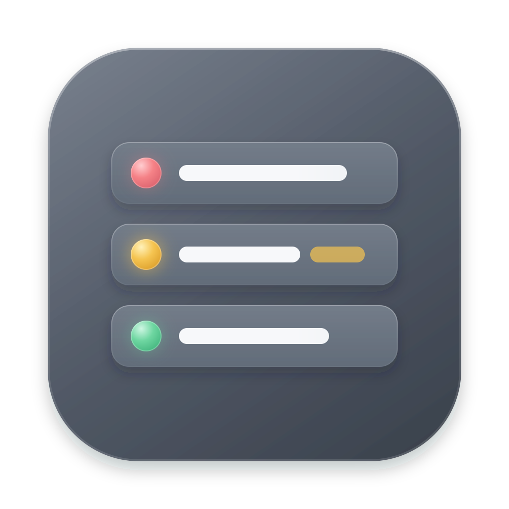
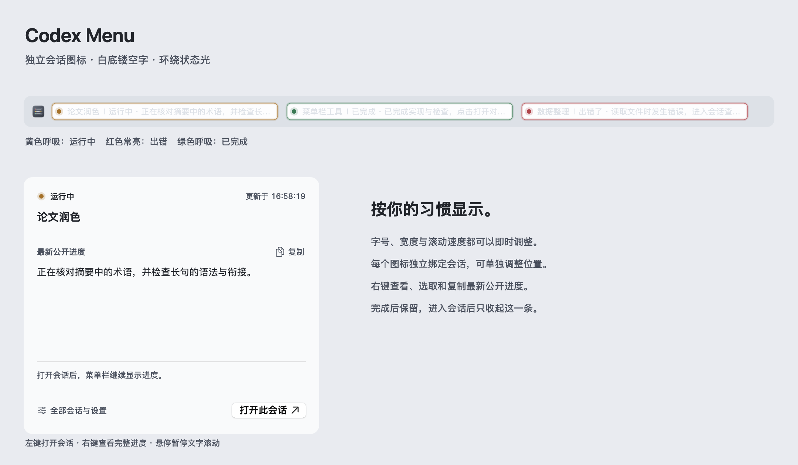

# Codex Menu



在 macOS 菜单栏用**独立图标**查看多个本机 Codex 会话的公开进度。原生 Swift / AppKit / SwiftUI 实现，无第三方运行时依赖，无需 API Key。



- 每个会话一个独立图标：左键打开对应会话，右键预览、选取和复制最新公开进度。
- 黄灯闪烁表示运行中，红灯常亮表示错误，绿灯闪烁表示完成；同时提供文字状态。
- 完成后保留，打开后仅收起该轮次；其他会话继续显示。
- 支持字体大小、条目宽度、滚动速度、浅色 / 深色主题、状态灯动画和登录启动设置。
- 总入口按状态列出全部保留会话，提供设置及溢出会话入口。

## 下载与命令行安装

需要 **macOS 13 或以上**，支持 **Apple Silicon 与 Intel**。使用 [GitHub Releases](https://github.com/wenrui0128/codex-menu/releases/latest) 的 `CodexMenu-macos-universal.zip`，无需安装 Xcode、Swift、Homebrew 或 Python。

安装前，请从菜单退出正在运行的旧版 Codex Menu。然后在终端执行：

```sh
curl -fsSL https://github.com/wenrui0128/codex-menu/releases/latest/download/install.sh -o /tmp/codex-menu-install.sh
bash /tmp/codex-menu-install.sh
```

安装器解析最新稳定版本，从同一版本下载 ZIP 和 `SHA256SUMS`，校验 SHA-256 及应用签名后安装到 `~/Applications/Codex Menu.app`，无需 `sudo`。安装不会自动启动、结束旧进程或改动会话数据。准备好后手动启动：

```sh
open "$HOME/Applications/Codex Menu.app"
```

只想下载、不安装：

```sh
bash /tmp/codex-menu-install.sh --download-only "$HOME/Downloads/CodexMenu"
```

指定版本或安装位置：

```sh
bash /tmp/codex-menu-install.sh --version v0.5.4 --dir "$HOME/Applications"
```

也可以从 Releases 手动下载 ZIP，解压后移动到 Applications。应用使用 **ad-hoc 本地签名，尚未经过 Apple 公证**。浏览器下载的应用若被 macOS 拦截，可在“系统设置 → 隐私与安全性”中批准打开；安装器不会全局关闭 Gatekeeper。

更新时退出旧版并重新运行安装命令，已有设置和保留条目继续使用。卸载时退出工具，将 `Codex Menu.app` 移到废纸篓即可；设置数据默认保留。

## 数据与范围

只读适配本机 Codex 保存的 SQLite 数据库和运行日志，显示会话名称、明确状态、**公开的 commentary / final 进度**及通用工具活动类型。**不读取或展示隐藏推理正文、推理摘要、命令内容、工具参数或命令输出**；不调用模型生成“思考过程”。读取器本身不发送网络请求，安装脚本只从 GitHub 下载。

不修改 Codex 客户端或侧栏，不连接远程 SSH / 云端会话。Codex 内部日志格式可能随版本变化，读取失败时会保留最后记录并提示核实。

设置和保留状态位于 `~/Library/Application Support/CodexMenu/state.json`。源码、安装包和示意图不包含真实会话数据。详细交互及读取方式见 [使用说明](CodexMenu/README.md)。

## 从源码构建

需要 Xcode 或带 Swift 的 Command Line Tools。命令只构建应用，不安装或启动：

```sh
git clone https://github.com/wenrui0128/codex-menu.git
cd codex-menu/CodexMenu
zsh scripts/build.sh
```

输出为 `CodexMenu/dist/Codex Menu.app`。构建 Universal 2 发布附件：

```sh
zsh scripts/release.sh
bash scripts/test-installer.sh
```

发布文件位于 `CodexMenu/release/v0.5.4/`，与日常构建目录分开。安装器测试只向临时目录下载，不安装或启动应用。

原生交互和数据读取测试：

```sh
env CLANG_MODULE_CACHE_PATH="$PWD/.build/clang-module-cache" \
  swift test --disable-sandbox --cache-path .build/cache \
  --config-path .build/config --security-path .build/security
```

交互测试需要可用的 macOS 图形会话。推送与 `CodexMenu/VERSION` 一致的 `v*` 标签会触发 GitHub Actions 构建发布包；手动触发工作流只生成可下载的构建附件。

## 许可与致谢

[MIT License](LICENSE)。菜单组织与设置设计参考 [Codex Status Bar](https://github.com/yuriipalam/codex-status-bar)，归属说明见 [THIRD_PARTY_NOTICES.md](CodexMenu/THIRD_PARTY_NOTICES.md)。本项目不是 OpenAI 官方产品。
