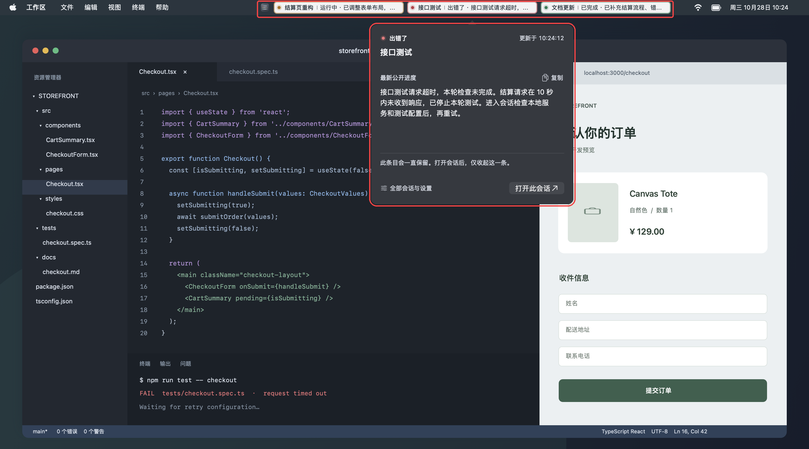

# Codex Menu

在 macOS 菜单栏查看多个 Codex 会话的状态和公开进度。

- 每个会话一个独立图标，左键打开会话，右键预览完整进度。
- 运行中黄色呼吸光，出错红色常亮，完成绿色呼吸光。
- 完成后保留，点击打开后只收起这一条，其他会话继续显示。
- 支持字号、宽度、颜色和滚动设置，可在程序中设置登录后启动。



[查看高清图](CodexMenu/Assets/usage-preview.png)

## 安装

支持 macOS 13 或以上，Apple Silicon / Intel。

[下载最新版本](https://github.com/wenrui0128/codex-menu/releases/latest)，解压后打开 `Codex Menu.app`。

命令行安装（默认 `~/Applications`，无需 sudo，需自行设置自动启动）：

```sh
curl -fsSL https://github.com/wenrui0128/codex-menu/releases/latest/download/install.sh -o /tmp/codex-menu-install.sh
bash /tmp/codex-menu-install.sh
```

安装后手动打开：

```sh
open "$HOME/Applications/Codex Menu.app"
```

只下载、不安装：

```sh
bash /tmp/codex-menu-install.sh --download-only "$HOME/Downloads/CodexMenu"
```

更新前请先退出旧版。安装器会校验 SHA-256 和应用签名。应用尚未经过 Apple 公证，如被 macOS 拦截，可在“系统设置 → 隐私与安全性”中批准打开。

只读取本机保存的会话状态和公开进度，不读取隐藏思考过程，不需要 API Key。

[详细说明与源码构建](CodexMenu/README.md) · [MIT License](LICENSE)

菜单与设置设计参考 [Codex Status Bar](https://github.com/yuriipalam/codex-status-bar)。本项目不是 OpenAI 官方产品。
